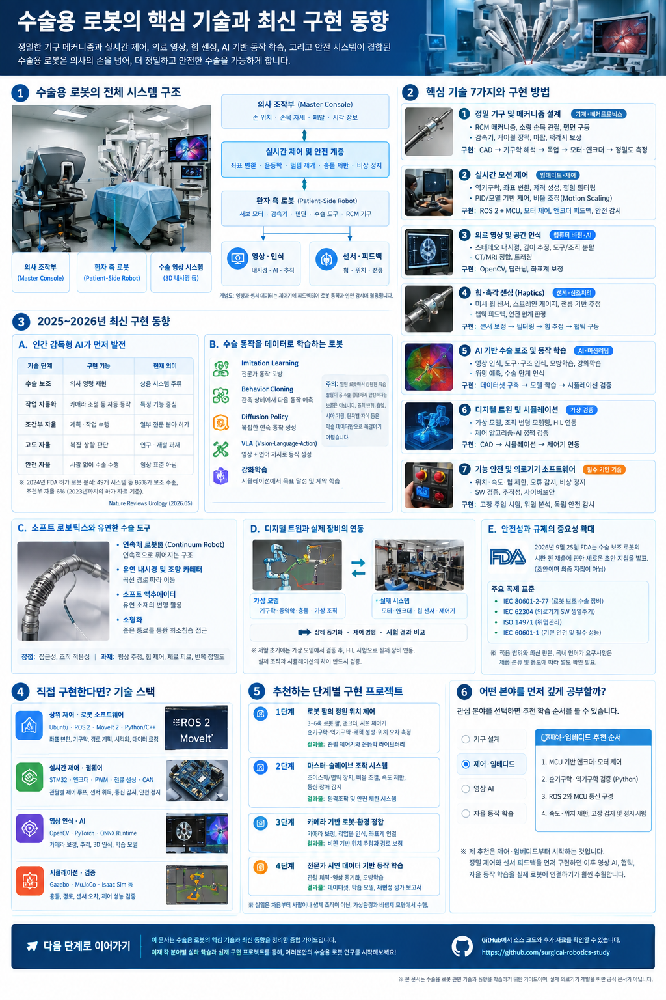
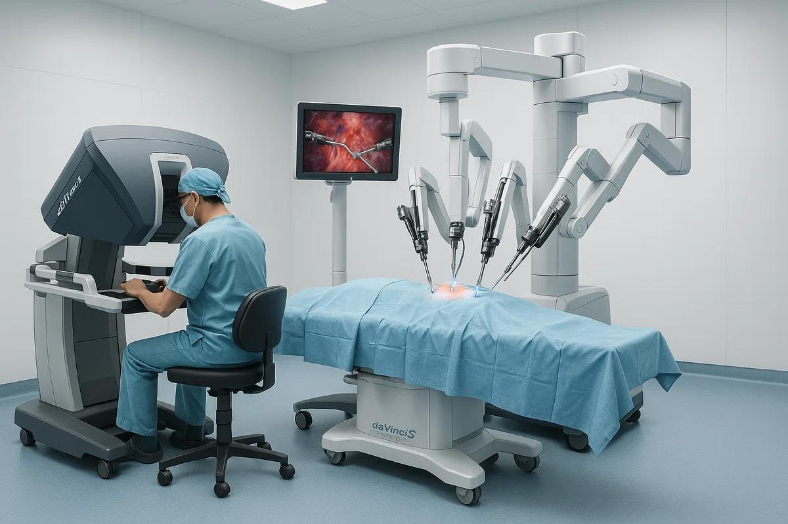
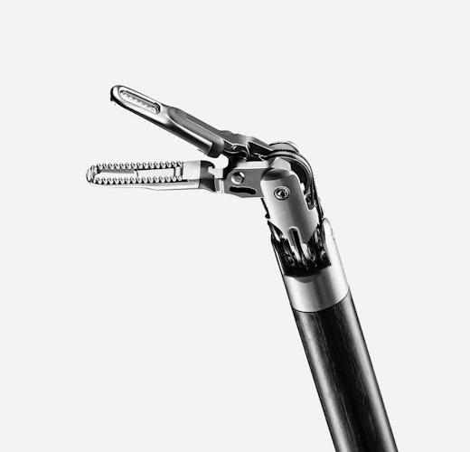
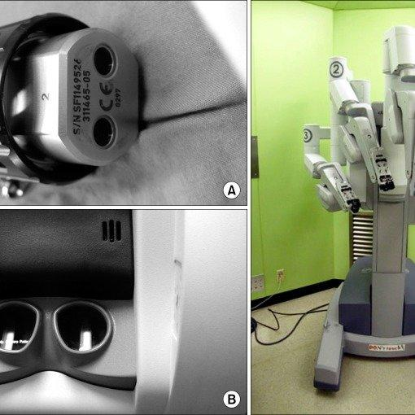

# 수술용 로봇의 핵심 기술과 최신 구현 동향

수술용 로봇(Surgical Robotics)을 기술적으로 이해하려면 로봇 팔 자체보다 정밀 기구, 실시간 제어, 의료 영상, 힘 센싱, AI 기반 동작 학습, 안전 시스템을 하나로 통합하는 기술에 주목해야 합니다.

특히 기존의 수술용 로봇이 의사의 손동작을 정밀하게 재현하는 데 초점을 맞췄다면, 최신 연구는 수술 장면을 인식하고 의사의 시범 동작을 학습하며 제한된 작업을 자율적으로 수행하는 방향으로 발전하고 있습니다. 다만 연구 단계의 자율 수술과 실제 임상에서 허가받은 기능은 구분해야 합니다.




---

## 1. 수술용 로봇의 전체 시스템 구조



 


수술용 로봇은 크게 의사가 조작하는 마스터 시스템, 환자 측에서 움직이는 슬레이브 로봇, 수술 영상 시스템, 실시간 제어기, 안전 감시 시스템으로 구성됩니다.

```
┌────────────────────────────────────────────────────────┐
│               의사 조작부 (Master Console)             │
│            손 위치 · 손목 자세 · 페달 · 시각 정보      │
└───────────────────────────┬────────────────────────────┘
                            ↕
┌────────────────────────────────────────────────────────┤
│               실시간 제어 및 안전 계층                 │
│      좌표 변환 · 운동학 · 떨림 제거 · 충돌 제한 · 비상 정지 │
└───────────────────────────┬────────────────────────────┘
                            ↕
┌────────────────────────────────────────────────────────┐
│             환자 측 로봇 (Patient-Side Robot)          │
│       서보 모터 · 감속기 · 텐던 · 수술 도구 · RCM 기구 │
└────────────────────────────────────────────────────────┘

┌───────────────────────────┬────────────────────────────┐
│         영상·인식         │         센서·피드백        │
│     내시경 · AI · 추적    │      힘 · 위치 · 전류      │
└───────────────────────────┴────────────────────────────┘
```

개념도: 영상과 센서 데이터는 제어기에 피드백되어 로봇 동작과 안전 감시에 활용됩니다.


* **의사 조작부 (Master Console)**: 손 위치 · 손목 자세 · 페달 · 시각 정보
* **실시간 제어 및 안전 계층**: 좌표 변환 · 운동학 · 떨림 제거 · 충돌 제한 · 비상 정지
* **환자 측 로봇 (Patient-Side Robot)**: 서보 모터 · 감속기 · 텐던 · 수술 도구 · RCM 기구
* **영상·인식**: 내시경 · AI · 추적
* **센서·피드백**: 힘 · 위치 · 전류

> **개념도:** 영상과 센서 데이터는 제어기에 피드백되어 로봇 동작과 안전 감시에 활용됩니다.

핵심은 각 부품의 성능만 높이는 것이 아니라, 센서에서 얻은 정보가 제어기에 전달되고 실제 기구의 움직임으로 이어지는 전체 폐루프(closed-loop)를 안정적으로 구현하는 것입니다.

004.jpg
Add files via upload
9 minutes ago
005.jpg
Add files via upload
4 minutes ago
006.jpg
Add files via upload
4 minutes ago
007.jpg
Add files via upload
4 minutes ago
008.jpg
Add files via upload
4 minutes ago
009.jpg
Add files via upload
4 minutes ago
010.jpg
Add files via upload
4 minutes ago
011.jpg
Add files via upload
4 minutes ago
012.jpg
Add files via upload
4 minutes ago
013.jpg
Add files via upload
4 minutes ago
014.jpg
Add files via upload
4 minutes ago
015.jpg
Add files via upload
4 minutes ago
016.jpg
Add files via upload
4 minutes ago
017.jpg
Add files via upload
4 minutes ago
018.jpg
Add files via upload
4 minutes ago
019.jpg
Add files via upload
4 minutes ago
020.jpg

---

## 2. 핵심 기술 7가지와 구현 방법

### ① 정밀 기구 및 메커니즘 설계 (기계·메카트로닉스)
* **RCM(Remote Center of Motion)**: 기구가 절개 부위를 중심으로 회전하도록 설계
* 텐던 구동 및 소형 손목 관절로 좁은 공간에서 정밀 조작
* 감속기, 케이블 장력, 마찰, 백래시 보상
* **구현:** CAD $\rightarrow$ 기구학 해석 $\rightarrow$ 3D 프린팅 목업 $\rightarrow$ 모터·엔코더 장착 $\rightarrow$ 위치 정밀도 측정

### ② 실시간 모션 제어 (임베디드·제어)
* 역기구학(IK), 좌표 변환, 관절 궤적 생성
* PID 및 모델 기반 제어, 손 떨림 필터링
* 손 움직임과 로봇 동작 사이의 비율 조정(Motion Scaling)
* **구현:** ROS 2로 상위 명령을 처리하고, MCU 또는 실시간 제어기에서 모터 제어·엔코더 피드백·안전 감시 수행

### ③ 의료 영상 및 공간 인식 (컴퓨터 비전·AI)
* 스테레오 내시경의 깊이 추정
* 조직·혈관·수술 도구 분할 및 추적
* CT/MRI와 수술 중 영상의 좌표 정합
* **구현:** OpenCV, 깊이 추정, 딥러닝 분할 모델을 적용하고, 카메라 좌표계와 로봇 좌표계를 보정합니다.

### ④ 힘·촉각 센싱 (Haptics) (센서·신호처리)
* 미세 힘 센서 또는 스트레인 게이지
* 모터 전류 기반 접촉력 추정
* 의사 조작부로 힘을 되돌리는 햅틱 피드백
* **구현:** 센서 보정 $\rightarrow$ 노이즈 필터링 $\rightarrow$ 힘 추정 $\rightarrow$ 안전 한계 판정 $\rightarrow$ 햅틱 장치 구동. 전류 추정은 마찰과 기구의 탄성 때문에 실제 접촉력을 정확히 대변하지 못할 수 있습니다.

### ⑤ AI 기반 수술 보조 및 동작 학습 (AI·머신러닝)
* 수술 영상에서 도구와 해부학적 구조 인식
* 의사의 동작 시범을 이용한 모방학습(IL)
* 시연 데이터와 강화학습(RL)을 활용한 동작 정책 학습
* 위험 동작 예측 및 수술 단계 인식
* **구현:** 영상·관절 궤적 동기화 $\rightarrow$ 동작 데이터셋 구축 $\rightarrow$ 모델 학습 $\rightarrow$ 시뮬레이션 검증 $\rightarrow$ 제한된 작업 평가

### ⑥ 디지털 트윈 및 시뮬레이션 (가상 검증)
* 로봇 기구·모터·센서의 가상 모델
* 조직의 변형과 기구 접촉 모델링
* 실제 장비를 연결하는 HIL(Hardware-in-the-Loop)
* 가상환경에서 제어 알고리즘과 AI 정책 검증
* **구현:** CAD 모델 $\rightarrow$ 물리 시뮬레이션 $\rightarrow$ 제어기 연동 $\rightarrow$ 실제 센서·모터 인터페이스 연결

### ⑦ 기능 안전 및 의료기기 소프트웨어 (필수 기반 기술)
* 관절별 위치·속도·힘 제한
* 통신 단절, 센서 오류, 전원 장애 감지
* 비상 정지와 안전한 정지 상태 전환
* 소프트웨어 검증, 추적성, 사이버보안
* **구현:** 정상 동작뿐 아니라 고장 주입 시험, 위험 분석, 독립적인 안전 감시 경로까지 설계합니다.

이 기술들은 서로 독립적이지 않습니다. 예를 들어 영상 AI가 조직을 잘못 인식하면 로봇의 경로 계획이 잘못될 수 있으므로, AI의 판단을 실제 움직임에 반영하기 전에도 별도의 안전 제한이 필요합니다.

---

## 3. 2025~2026년 최신 기술 동향

### 동향 A. 완전 자율 수술보다 인간 감독형 AI가 먼저 발전
2026년 5월 Nature Reviews Urology에 발표된 리뷰는 AI의 유망한 단기 적용 분야로 해부학적 구조 인식, 위험 감지, 수술 중 내비게이션, 수행 능력 평가 및 피드백을 강조합니다. 즉, 의사를 대체하는 AI보다 의사의 판단과 동작을 지원하는 AI가 현실적인 발전 경로입니다.

| 기술 단계 | 구현 기능 | 현재 의미 |
| :--- | :--- | :--- |
| **수술 보조** | 의사 명령을 정밀하게 재현 | 상용 시스템의 주류 |
| **작업 자동화** | 카메라 위치 조절, 제한된 동작 자동 실행 | 특정 기능 중심으로 구현 |
| **조건부 자율** | 특정 조건에서 계획·작업을 수행 | 일부 전문 분야에서 허가 사례 존재 |
| **고도 자율** | 복잡한 상황을 판단하며 여러 작업 수행 | 연구·개발 과제 |
| **완전 자율** | 사람의 지속적인 조작 없이 수술 수행 | 일반적인 임상 표준은 아님 |

2024년 FDA 허가 로봇을 분석한 체계적 문헌고찰에서는 조사 대상 49개 시스템 중 86%가 지속적인 의사 제어를 받는 보조 수준이었으며, 조건부 자율 수준은 6%였습니다. (이 수치는 2023년까지의 허가 자료를 분석한 결과이며, 2026년 전체 시스템의 비율과는 다를 수 있습니다.)

### 동향 B. 수술 동작을 데이터로 학습하는 로봇
기존에는 엔지니어가 로봇의 움직임을 일일이 프로그래밍했다면, 이제는 숙련된 의사의 수술 영상과 기구 궤적을 수집해 동작 정책을 학습하는 접근이 중요해지고 있습니다.
* **Imitation Learning:** 전문가가 수행한 동작을 모방하도록 학습
* **Behavior Cloning:** 관측 상태에서 다음 동작을 예측
* **Diffusion Policy:** 시연 데이터에서 복잡한 연속 동작을 생성
* **Vision-Language-Action (VLA):** 영상과 언어 지시를 결합해 동작을 생성하는 연구 방향
* **강화학습:** 시뮬레이션에서 목표 달성 및 제약 조건을 학습

> **주의점:** 일반 로봇에서 검증된 학습 방법이 곧바로 수술 환경에서 안전하다는 뜻은 아닙니다. 조직의 변형, 출혈, 시야 가림, 환자별 차이 등은 학습 데이터만으로 해결하기 어렵습니다.

### 동향 C. 소프트 로보틱스와 유연한 수술 도구
2026년 발표된 소프트 로보틱스 리뷰는 유연한 구조를 이용해 좁고 복잡한 인체 내부에 접근하는 기술을 다룹니다.
* **연속체 로봇 (Continuum Robot):** 여러 관절 대신 연속적으로 휘어지는 구조
* **유연 내시경 및 조향 카테터:** 곡선 경로를 따라 이동
* **소프트 액추에이터:** 유연한 재료의 변형을 활용
* **소형화:** 좁은 통로를 통한 최소침습 접근

기존 강체 로봇은 위치 정밀도와 강성 확보에 유리하지만, 유연 로봇은 접근성과 조직 적응성에서 장점이 있습니다. 대신 형상 추정, 힘 제어, 재료의 피로 및 반복 정밀도 문제가 더 까다로워집니다.

### 동향 D. 디지털 트윈과 실제 장비의 연동
디지털 트윈은 단순한 3D 시각화가 아닙니다. 실제 로봇의 관절 상태, 센서값, 제어 명령과 가상 모델을 연결해 시스템의 동작을 검증하는 기술입니다.
* **가상 모델:** 기구학·동역학·충돌·가상 조직
* **실제 시스템:** 모터·엔코더·힘 센서·제어기
* **연동 구조:** 상태 동기화 $\leftrightarrow$ 제어 명령 $\leftrightarrow$ 시험 결과 비교

개발 초기에는 가상 모델에서 알고리즘을 검증하고, 이후 실제 하드웨어를 연결하는 HIL 시험으로 옮기는 방식이 유용합니다. 다만 실제 조직과 시뮬레이션의 차이를 반드시 검증해야 합니다.

### 동향 E. 안전성과 규제의 중요성 확대
2026년 9월 25일 미국 FDA는 수술 보조 로봇의 시판 전 제출에 관한 새로운 초안 지침을 발표했습니다. 비임상 시험, 임상 데이터, 제품 표시 등에 관한 권고를 담고 있으나, 아직 초안이며 최종 지침이나 그 자체로 새로운 법적 의무를 의미하지는 않습니다.

개발 단계에서 살펴볼 주요 표준은 다음과 같습니다.
* **IEC 80601-2-77:** 로봇 보조 수술 장비의 기본 안전과 필수 성능
* **IEC 62304:** 의료기기 소프트웨어 생명주기
* **ISO 14971:** 의료기기 위험관리
* **IEC 60601-1:** 의료용 전기기기의 기본 안전과 필수 성능

각 표준의 적용 범위와 최신 판본, 국내 인허가 요구사항은 제품의 분류 및 용도에 따라 별도로 확인해야 합니다.

---

## 4. 직접 구현한다면 어떤 기술 스택이 적합할까?

지금까지의 FPGA·임베디드·로봇 제어 기술을 활용해 연구용 프로토타입을 만든다고 가정하면, 아래 구성이 현실적입니다.

* **상위 제어·로봇 소프트웨어:** Ubuntu, ROS 2, MoveIt 2, Python/C++ (좌표 변환, 기구학, 경로 계획, 시각화, 데이터 로깅 담당)
* **실시간 제어·펌웨어:** STM32, 엔코더, PWM, 전류 센싱, CAN (관절별 제어 루프, 센서 취득, 통신 감시 및 안전 정지 로직 구현)
* **영상 인식·AI:** OpenCV, PyTorch, ONNX Runtime (카메라 보정, 물체 추적, 기구 위치 추정부터 시작해 학습 모델을 단계적으로 추가)
* **시뮬레이션·검증:** Gazebo, MuJoCo, Isaac Sim 등 (충돌, 경로, 센서 오차 및 제어 성능을 가상환경에서 시험한 후 실제 장비와 결과를 비교)

이 구성은 연구용 로봇 팔에 적합한 출발점입니다. 실제 수술용 장비로 발전시키려면 멸균 가능한 기구, 생체적합 재료, 임상 요구사항, 독립적인 안전 설계와 의료기기 검증을 추가해야 합니다.

---

## 5. 추천하는 단계별 구현 프로젝트

* **1단계: 로봇 팔의 정밀 위치 제어**
  * 3~6축 연구용 로봇 팔, 엔코더, 서보 제어기를 이용해 순기구학·역기구학·궤적 생성·위치 오차 측정을 구현합니다.
  * **결과물:** 관절 제어기와 운동학 라이브러리
* **2단계: 마스터-슬레이브 조작 시스템**
  * 조이스틱 또는 햅틱 장치의 움직임을 로봇 팔에 전달하고, 움직임 비율 조절·속도 제한·통신 장애 감지를 구현합니다.
  * **결과물:** 원격조작 및 안전 제한 시스템
* **3단계: 카메라 기반 로봇-환경 정합**
  * 카메라를 보정하고 작업물의 위치를 인식해 로봇 좌표계와 영상 좌표계를 연결합니다.
  * **결과물:** 비전 기반 위치 추정과 경로 보정
* **4단계: 전문가 시연 데이터 기반 동작 학습**
  * 연구용 환경에서 로봇의 관절 상태, 영상, 명령 및 실행 결과를 수집하고 모방학습으로 제한된 작업을 수행하도록 합니다.
  * **결과물:** 시연 데이터셋, 학습 모델, 재현성 평가 보고서

> **안내:** 실험은 처음부터 사람이나 생체 조직을 대상으로 하지 않고, 가상환경과 비생체 모형에서 수행하는 것이 적절합니다.
